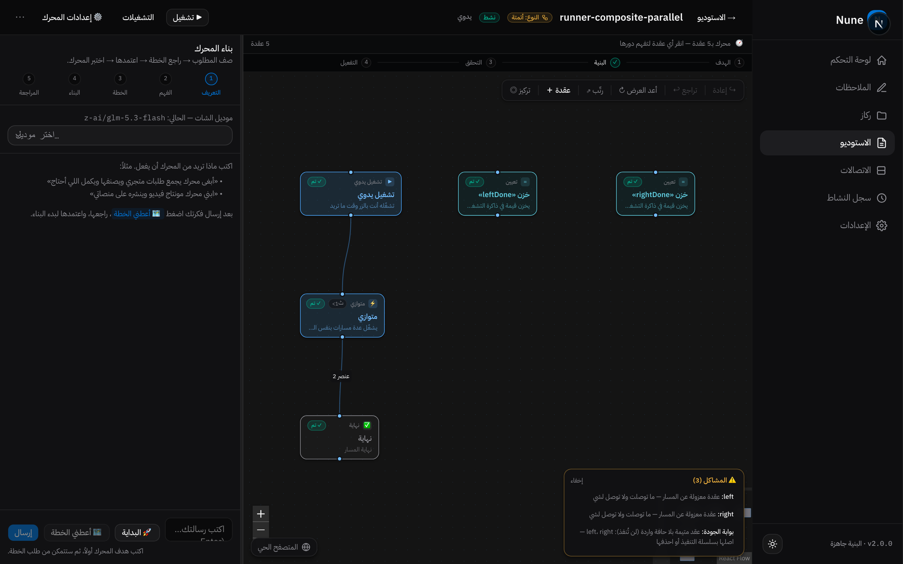
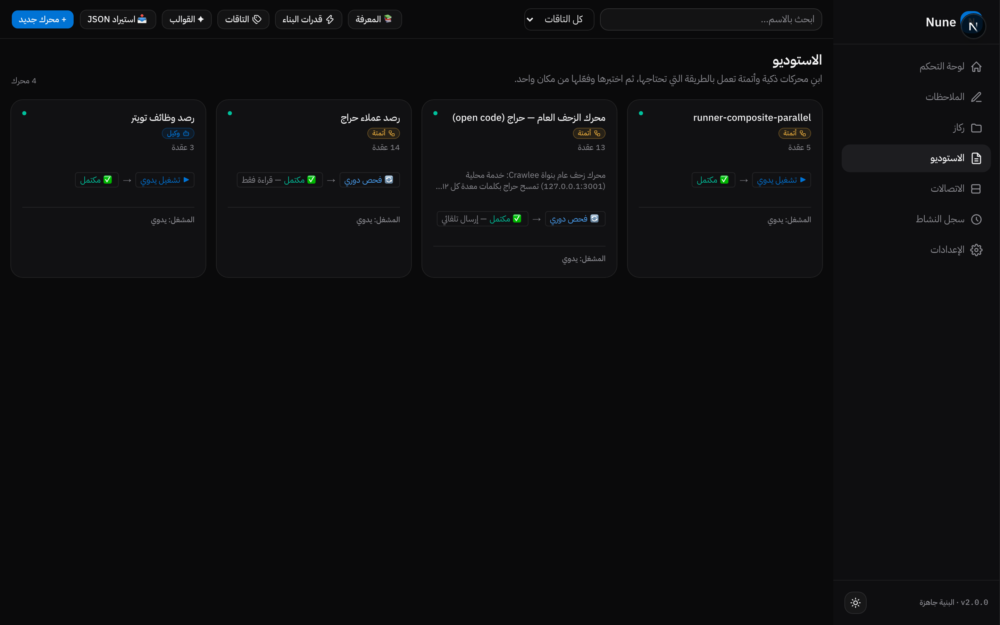
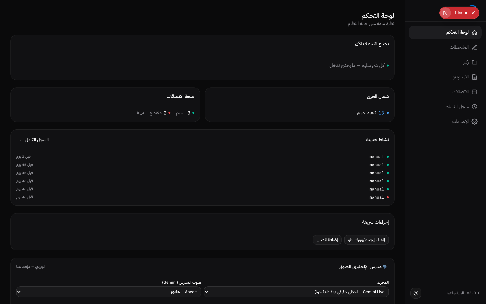
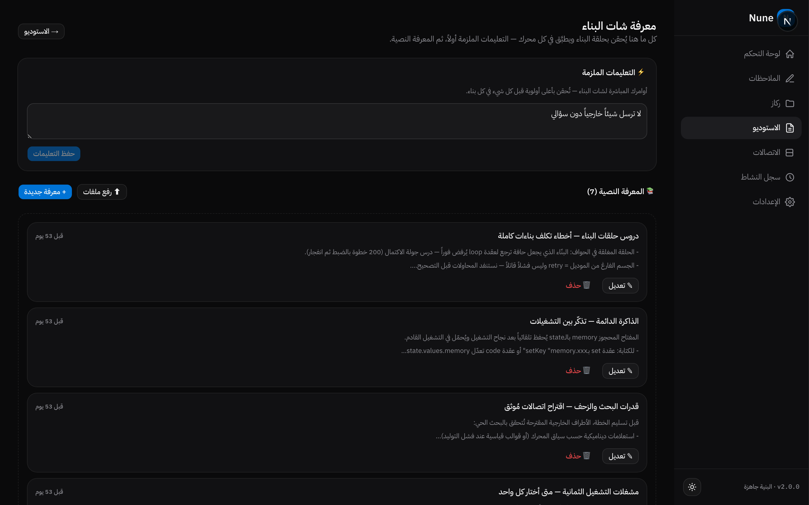

<div align="center">

# Nune — نظام تشغيل شخصي بالذكاء الاصطناعي

**منصة كاملة تُصنّع وكلاء ذكيين ومحركات أتمتة — بُنيت بالكامل عبر الشات، بمطوّر واحد، بلا فريق.**

*A full personal AI Operating System — designed and built entirely through AI-assisted conversation, by a single developer.*

</div>

---

## 💡 الفكرة

معظم أنظمة الأتمتة تتطلب فريقاً هندسياً. **Nune** يسأل سؤالاً مختلفاً:

> ماذا لو كان بناء محرك ذكي معقد أمراً يُنجز بالمحادثة وحدها — مع جودة مفحوصة ومضمونة؟

النتيجة: نظام تشغيل شخصي كامل (Personal OS) يجمع **مصنع محركات** + **إدارة مشاريع** + **قاعدة معرفة حية** + **اتصالات** في واجهة عربية واحدة.

---

## 🏭 المصنع — بناء المحركات بالشات

قل للمحرك ما تبيه بالعربية، وسيلتزم به حرفياً — كل محرك يمر عبر **حلقة بناء من 6 مراحل** ببوابات جودة إلزامية:

```
صِف المطلوب → اعتمده → راجع الخطة → اعتمرها → اختبر المحرك → اعتمرها للبناء
```

<p align="center">
  
</p>

- **٦ مراحل إلزامية** — لا تقفز فوق أساس ناقص، ولا تسليم بلا فحص
- **١٤+ نوع عقدة** (استدعاء موديل، كود، فحص بنيوي، تقييم دلالي، اختبار وهمي Mock، تصحيح، موازاة...)
- **فحص قبل التشغيل:** تحقق بنيوي + تقييم دلالي + اختبارات Mock — أي محرك لا يجتاز البوابة لا يُشغَّل
- **تصميم بصري:** عقد قابلة للسحب على لوحة تفاعلية، مع أزرار توجيه طيّار (Autopilot)

---

## 🎛️ الاستوديو — مكتبة المحركات

كل محرك: وكيل ذكي، وورك فلو ثابت، أو هجين — مع نسخ إصدارات وتشغيلات وسجل كامل.

<p align="center">
  
</p>

- محركات تشتغل بالجدولة أو الطلب أو الويب هوك
- سجل تشغيلات كامل لكل محرك (١٣٥+ تشغيل حقيقي مسجل)
- توقيع مُوثّق للمحركات المُنتَجة

---

## 📁 المشاريع — مساحة عمل لكل كيان

كل مشروع = ذاكرة + معرفة + وكلاء + اتصالات خاصة به، معزول عن الباقي.

<p align="center">
  
</p>

- **شات وكيل** يرى الوضع الحقيقي للمشروع ويكتب ببوابة موافقة
- **معرفة دائمة:** دروس وبناءات تُحفظ وتُعاد للسياق تلقائياً — المحرك لا يتعلم نفس الخطأ مرتين
- **قدرات قابلة للتوصيل:** أي API + توكن مشفر = أداة للوكلاء

---

## 🧠 المعرفة والقدرات

<p align="center">
  
</p>

- تعلمات مبنية تتراكم: أخطاء حقيقية تتحول لقواعد تُفحص قبل كل بناء
- أدوات بحث خارجية (Exa) مرتبطة مباشرة بشأن البناء

---

## 🎨 استوديو التصميم

<p align="center">
  
</p>

- توليد تصاميم وبانرات بمقاسات جاهزة (فيسبوك، انستقرام، تويتر...)
- مكتبة أصول + سجل إصدارات + فتح القالب للتعديل

---

## 📐 الأرقام

| | |
|---|---|
| **٣٠٦ اختبار** | كلها خضراء — انضباط هندسي كامل |
| **١٤+ نوع عقدة** | محرك تنفيذ قابل للتوسع |
| **٦ مراحل بناء** | حلقة جودة إلزامية لكل محرك |
| **١٣٥+ تشغيل** | سجل تشغيلات حقيقي موثق |
| **تشفير AES-256** | التوكنات والمفاتيح مشفرة بالكامل |
| **٤١٧+ موديل** | عبر OpenRouter — اختيار الموديل لكل سياق |
| **مطور واحد** | واجهة عربية RTL كاملة |

---

## 🛠️ التقنيات

`Next.js 16` · `React 19` · `TypeScript` · `SQLite (WAL)` · `Tailwind 4` · `Base UI` · `WebSockets` · `Playwright (E2E)` · `Vitest` · `WebAuthn (Passkeys)` · `AES-256-GCM` · `OpenRouter / Gemini Live`

---

## 🔒 الخصوصية والملكية

- **لا كود منشور هنا عمداً** — هذا المعرض يعرض القدرة، والملكية الفكرية محفوظة
- جميع بيانات العملاء مغفورة عن هذه الصفحة بالكامل
- مُسجّل وموثّق بتواريخ بناء تدريجية منذ أغسطس ٢٠٢٦

---

<div align="center">

**بُني بالكامل عبر الشات — مطوّر واحد × ذكاء اصطناعي**

[الملف المهني](#) · [لينكد إن](https://www.linkedin.com/in/nader-alshamrani-3444ab286)

</div>
