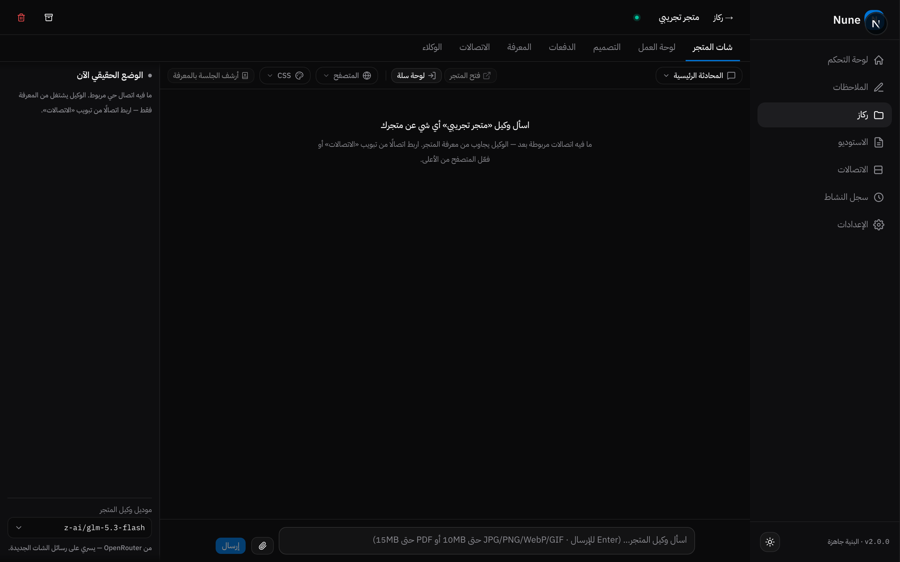
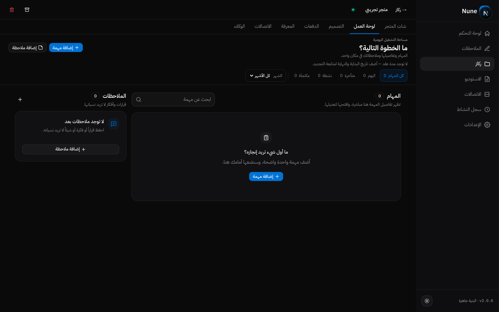
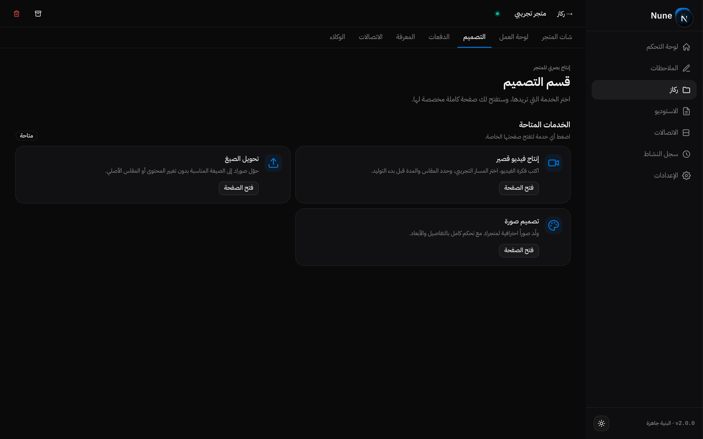
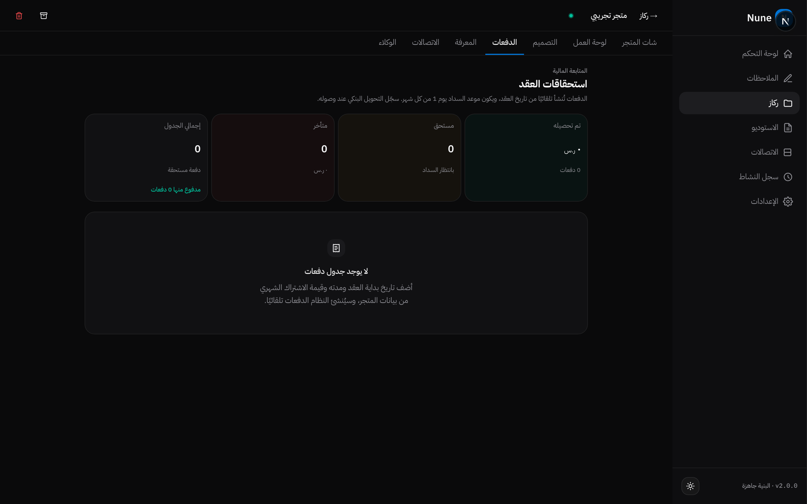
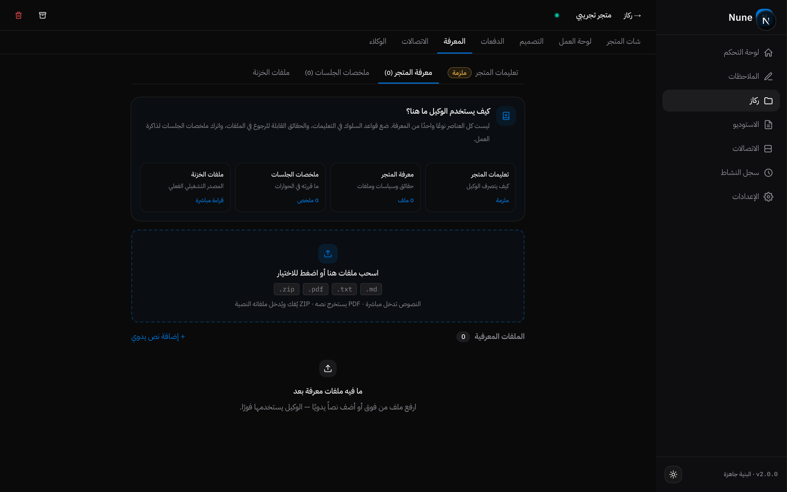
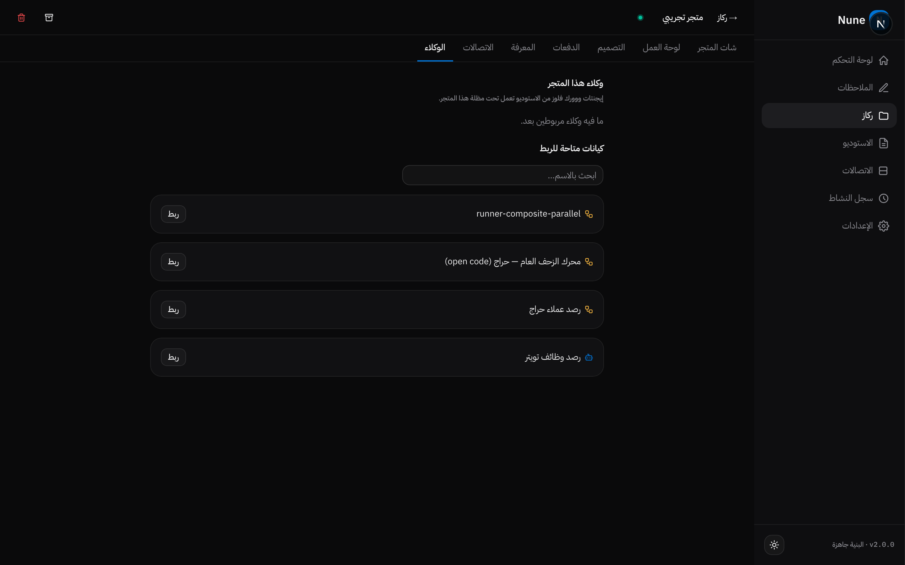

<div align="center">

# Nune — نظام تشغيل شخصي بالذكاء الاصطناعي

**منصة كاملة تُصنّع وكلاء ذكيين ومحركات أتمتة — بُنيت بالكامل عبر الشات، بمطوّر واحد، بلا فريق.**

*A full personal AI Operating System — designed and built entirely through AI-assisted conversation, by a single developer.*

</div>

---

## 💡 الفكرة

معظم أنظمة الأتمتة تتطلب فريقاً هندسياً. **Nune** يسأل سؤالاً مختلفاً:

> ماذا لو كان بناء محرك ذكي معقد أمراً يُنجز بالمحادثة وحدها — مع جودة مفحوصة ومضمونة؟

النتيجة: نظام تشغيل شخصي كامل (Personal OS) يجمع مصنع محركات + إدارة مشاريع + قاعدة معرفة حية + استوديو تصميم + مُدرّس صوتي لحظي — في واجهة عربية واحدة.

---

## 🧩 الأنظمة — نظرة عامة

| النظام | وش يسوي |
|--------|---------|
| **لوحة التحكم** | نبض النظام: نشاطات، جلسات بناء، إجراءات سريعة، ومدرس إنجليزي صوتي لحظي |
| **الملاحظات** | أعمدة ابل نوتس: بطاقات سحب وإفلات، طيّ ذكي، حفظ تلقائي |
| **ركاز** | مساحات عمل لكل كيان (متجر/مشروع) بذاكرة ومعرفة ووكلاء مستقلين |
| **الاستوديو** | مصنع المحركات: إيجنتات ووورك فلوز ومحركات هجينة بجودة مفحوصة |
| **الاتصالات** | أي API أو MCP أو بوت تيليقرام أو Google Sheets = أداة للوكلاء |
| **سجل النشاط** | كل تشغيل مُوثق: مصدر، الحالة، فشل محرك، وحلقات مراقبة |
| **الإعدادات** | مفاتيح مشفرة AES-256، قناة إشعار، نماذج 417+ عبر OpenRouter وGemini Live |

---

## 🏭 المصنع — بناء المحركات بالشات

قل للمحرك ما تبيه بالعربية، وسيلتزم به حرفياً — كل محرك يمر عبر **حلقة بناء من 6 مراحل** ببوابات جودة إلزامية:

```
صِف المطلوب → اعتمده → راجع الخطة → اعتمرها → اختبر المحرك → اعتمرها للبناء
```

<p align="center">
  
</p>

- **١٤+ نوع عقدة** (استدعاء موديل، كود، فحص بنيوي، تقييم دلالي، اختبار Mock، تصحيح، موازاة...)
- **فحص قبل التشغيل:** أي محرك لا يجتاز بوابة الجودة لا يُشغَّل
- **تصميم بصري:** عقد قابلة للسحب + أزرار توجيه طيّار (Autopilot)
- **فحص المتجر:** أداة تفحص أي متجر إلكتروني وتولّد تقرير احترافي مفصّل بالدرجات والفرص — `lib/tools/storeAudit.ts` (خارج هذا المعرض، لكن مثال حي لقدرة التصنيع)

---

## 🎛️ الاستوديو — مكتبة المحركات

<p align="center">
  
</p>

- كل محرك: **إيجنت ذكي / وورك فلو ثابت / هجين** — مع إصدارات وتشغيلات وسجل كامل
- ١٣٥+ تشغيل حقيقي موثق — تنبؤ، عمل حي، ورسائل تيليقرام
- توقيع مُوثّق للمحركات المُنتَجة

---

## 🏪 ركاز — مساحة عمل لكل متجر

كل متجر = كيان مستقل بذاكرة ومعرفة ووكلاء واتصالات خاصة به. عزلت حقيقية بين العملاء:

### شات المتجر — وكيل يرى الوضع الحقيقي
<p align="center">
  
</p>

- شات ذكي بذاكرة عابرة + معرفة دائمة، ويمكنه **فحص متجرك الحي** وملاحظة أي تغيّر
- اختيار الموديل لكل شات من 417+ موديل، إرفاق صور (multimodal) حتى 10MB
- نمط "متجر تجريبي" يظهر للعرض العام — وكيل محايد بلا بيانات عملاء

### لوحة العمل — المهام والملاحظات
<p align="center">
  
</p>

- مهام بتواريخ يومية وأسبوعية، وملاحظات سريعة — كلها بذاكرة المتجر نفسها

### قسم التصميم — خدمات إنتاج مدمجة
<p align="center">
  
</p>

- **إنتاج فيديو قصير** — اختر المسار التجريبي وعدد المقاطع والمدة قبل التوليد
- **تصميم صورة** — لوحة مُوجّهة بمتجر مخصص للبانرات والأيدنتيتي
- **تحويل الصيغ** — صور بلا تعديل محتوى أو مقادس أصلي

### الدفعات — المتابعة المالية
<p align="center">
  
</p>

- دفعات مبدئية وبيانات سداد — تنعقد تلقائياً من بيانات المتجر وتُشترط بانتظار الدفع

### المعرفة — حافات وسياسات ومفاتيح
<p align="center">
  
</p>

- **تعليمات المتجر** (إلزامية) · **معرفة المتجر** · **ملخصات الجلسات** · **ملفات الخزنة** — أربع طبقات معرفة تُستخدم بالتدفق الصحيح
- رفع ZIP / PDF / نصوص تُفهرس تلقائياً

### الوكلاء — محركات تعمل تحت مظلة المتجر
<p align="center">
  
</p>

- اربط محركاً من الاستوديو ليشتغل تلقائياً داخل متجرك — مع سجل كامل

### وكيل التصميم — يفحص متجرك الحي ويعطيك الكود
<p align="center">
  
</p>

- مدمج بمتصفح حي (Chrome حقيقي بملف تعريف متجر واحد) — يشوف شكل متجرك الفعلي ويعدّله بـCSS حقيقي

---

## 🧠 المعرفة الدائمة — النظام يتعلم نفسه

<p align="center">
  
</p>

- **حلقة بناء تتراكم:** أخطاء حقيقية تتحول لقواعد تُفحص قبل كل بناء جديد
- تعلمات موقعة بالتاريخ — "دروس جلقة اللقاء — أخطاء تكلف بناءات كاملة" ثم تصحح في المرات القادمة
- أدوات بحث خارجية (Exa) مرتبطة مباشرة بشأن البناء

---

## 📐 الأرقام

| | |
|---|---|
| **٣٠٦ اختبار** | كلها خضراء — انضباط هندسي كامل |
| **١٤+ نوع عقدة** | محرك تنفيذ قابل للتوسع |
| **٦ مراحل بناء** | حلقة جودة إلزامية لكل محرك |
| **١٣٥+ تشغيل** | سجل تشغيلات حقيقي موثق |
| **١٢+ أداة محلية** | متصفح حي، خزنة ملفات، أوبسيديان، بحث ويب، حراج |
| **تشفير AES-256** | التوكنات والمفاتيح مشفرة بالكامل |
| **٤١٧+ موديل** | عبر OpenRouter — اختيار الموديل لكل سياق |
| **مطور واحد** | واجهة عربية RTL كاملة |

---

## 🛠️ التقنيات

`Next.js 16` · `React 19` · `TypeScript` · `SQLite (WAL)` · `Tailwind 4` · `Base UI` · `Xyflow` · `WebSockets` · `Playwright (E2E)` · `Vitest` · `WebAuthn (Passkeys)` · `AES-256-GCM` · `OpenRouter` · `Gemini Live (Realtime)` · `Crawlee` · `CDP (Chrome DevTools Protocol)`

---

## 🎤 إضافات داخل النظام

- **مدرس إنجليزي صوتي لحظي** — Gemini Live Realtime: تحدث وحوّل حي للمخرج، مع مقاطعة لحظية أثناء الرد
- **متصفح حي للوكلاء** — Chrome حقيقي بمثبث ملف تعريف لكل متجر: الوكيل والمستخدم نفس الجلسة
- **راحة جدولة وتريغدز** — مشغّلات يدوية، مواعيد، ويب هوك، وأزرار توجيه طيّار

---

## 🔒 الخصوصية والملكية

- **لا كود منشور هنا عمداً** — هذا المعرض يعرض القدرة، والملكية الفكرية محفوظة
- جميع بيانات العملاء مغفورة عن هذه الصفحة بالكامل — كل لقطة إما فارغة أو من "متجر تجريبي" مُنصّر خصيصاً للعرض
- مُسجّل وموثّق بتواريخ بناء تدريجية منذ أغسطس ٢٠٢٦

---

<div align="center">

**بُني بالكامل عبر الشات — مطوّر واحد × ذكاء اصطناعي**

[لينكد إن](https://www.linkedin.com/in/nader-alshamrani-3444ab286)

</div>
